::: {custom-style="Title"}
基于 PCA 特征降维与多分类器集成的手写数字识别方法研究
:::

::: {custom-style="AuthorLine"}
张三 （学号：2023XXXXXX）  指导教师：XXX
:::

::: {custom-style="AuthorLine"}
（XX大学  XX学院  XX专业  XX班）
:::

**摘要**：手写数字识别是模式识别与机器学习领域的经典问题，在邮政分拣、银行票据处理、快递面单录入与考试阅卷等场景中具有直接的工程应用价值。针对原始像素特征维度高、冗余大以及单一分类器泛化能力有限的问题，本文以 MNIST 数据集（70 000 张 28×28 灰度图像）为研究对象，构建了"数据预处理—特征降维—分类器训练—概率集成"的完整识别流水线。首先对图像进行归一化与中心化，采用主成分分析（PCA）将 784 维像素特征压缩至 {{NCOMP}} 维（累计解释方差 95%），并结合 HOG 梯度特征进行对照；随后在 k 近邻、支持向量机、随机森林与多层感知机四种分类器上系统比较了不同特征表示的识别性能，并以软投票策略将三种互补的基分类器集成为最终模型。实验结果表明：PCA 降维在保留识别精度的同时将特征维度压缩约 {{DIMRATIO}}%，显著降低训练与推理开销；集成模型在 10 000 张测试图像上取得 {{ACC_ENS}} 的准确率与 {{F1_ENS}} 的宏平均 F1 值，优于全部单一模型；置信度校准分析表明，集成模型的置信度输出与真实正确率保持一致，而单一多层感知机的置信度系统性偏高，为基于阈值的拒识机制提供了可靠的不确定性估计基础；在票据手写数字自动录入的原型系统中，整串识别准确率达到 {{APP_ACC}}，验证了方法面向实际应用的可行性。本文工作为中小规模字符识别任务在普通 CPU 环境下的轻量化实现提供了可复用的技术路线。

**关键词**：手写数字识别；主成分分析；支持向量机；集成学习；scikit-learn

::: {custom-style="AbstractEN"}
**Abstract**: Handwritten digit recognition is a classic problem in pattern recognition with direct engineering value in postal sorting, bank check processing and form digitization. To address the high dimensionality and redundancy of raw pixel features as well as the limited generalization of single classifiers, this paper builds a complete pipeline of preprocessing, feature reduction, classifier training and probabilistic ensemble on the MNIST dataset (70,000 grayscale images of 28×28 pixels). Principal Component Analysis (PCA) compresses the 784-dimensional pixel features to {{NCOMP}} dimensions (95% cumulative explained variance). Four classifiers—k-Nearest Neighbors, Support Vector Machine, Random Forest and Multi-Layer Perceptron—are systematically compared, and a soft-voting ensemble of three complementary base classifiers is constructed. The ensemble achieves an accuracy of {{ACC_ENS}} and a macro-F1 of {{F1_ENS}} on the 10,000-image test set, outperforming all single models. Calibration analysis further shows that the ensemble's confidence output is well aligned with empirical accuracy, whereas a single Multi-Layer Perceptron is systematically over-confident, providing a reliable basis for threshold-based rejection. An exact-match rate of {{APP_ACC}} is achieved in a prototype form-digitization application.
:::

::: {custom-style="AbstractEN"}
**Keywords**: handwritten digit recognition; principal component analysis; support vector machine; ensemble learning; scikit-learn
:::

# 1 引言

## 1.1 研究背景与意义

让机器"看懂"手写数字，是模式识别学科发展历程中最具代表性的问题之一。20 世纪 90 年代，美国邮政服务每天需要处理数以亿计的手写信件，邮政编码的自动识别直接决定了邮件分拣的效率，LeCun 等人正是以此为契机提出了卷积神经网络 LeNet-5，将手写数字的错误率降低到商业可用的水平[1]。此后，手写数字识别作为字符识别（Optical Character Recognition, OCR）的典型子问题，广泛出现在银行支票金额识别、快递面单录入、考试答题卡阅卷、财务报销单据数字化等真实业务中。

手写数字识别之所以长期被作为算法研究的基准问题，在于它"规模小而要素全"：输入是低分辨率灰度图像，类别只有 10 个，但书写风格因人而异、字形存在形变与歧义，数据蕴含的非线性结构足以检验特征提取与分类算法的建模能力。因此，它既是入门机器学习的标准案例，也是检验特征工程、模型选择与集成策略等通用方法论的实验平台。在中文语境下，类似的技术路线可以直接迁移到车牌字符识别、工业表面缺陷检测等更复杂的实际任务中，具有很强的示范意义。

## 1.2 研究现状

手写数字识别的发展大致经历了三个阶段。

早期研究以统计模式识别与结构模式识别为主，代表方法包括最近邻模板匹配、贝叶斯决策与神经网络浅层模型。这一时期的核心思想是人工设计特征：从图像中提取轮廓、投影、矩特征等，再用简单分类器完成判别。

20 世纪 90 年代，以支持向量机（Support Vector Machine, SVM）为代表的统计学习方法与以 LeNet-5 为代表的卷积神经网络相继出现[1][2]。LeCun 等在 MNIST 数据集上的系统实验表明，卷积网络可将错误率降至 1% 以下，而经过良好特征设计的 SVM 也能取得相近性能，两者共同确立了该问题的技术基线[1]。与此同时，主成分分析（PCA）等线性降维方法被广泛用于压缩高维像素特征，在大幅降低计算量的同时保持识别精度，成为特征工程的经典手段[4]。

2012 年以后，深度卷积网络在图像识别领域全面领先，手写数字识别的最好成绩已超过 99.7% 的准确率。然而深度模型的训练依赖 GPU 算力与大规模参数调优，在算力受限的嵌入式设备、边缘终端以及中小规模业务系统中，"人工特征 + 经典机器学习模型"的轻量方案仍然具有工程价值：其训练开销小、可解释性强、部署门槛低，且通过特征降维与模型集成可以进一步逼近复杂模型的效果。此外，梯度方向直方图（Histogram of Oriented Gradients, HOG）等纹理特征在字符识别中亦有成熟应用[5]。因此，在经典框架内系统研究特征表示与分类器的匹配关系，并利用集成学习提升稳健性[7][10]，兼具学习价值与实用意义。

## 1.3 本文的主要工作

本文面向实际应用需求，在 Python 与 scikit-learn 生态下完成了手写数字识别的完整工程实现与系统实验，主要工作包括：

（1）构建了覆盖"预处理—特征降维—分类—集成"全流程的识别系统，全部代码模块化组织，可直接复现论文中的全部实验；

（2）系统比较了原始像素、PCA 主成分与 HOG 梯度三种特征表示在 kNN、线性 SVM、RBF 核 SVM、随机森林与多层感知机五种分类器上的性能表现，共形成 8 组"特征—分类器"组合的量化结果；

（3）以软投票策略构建多分类器集成模型，在测试集上取得优于全部单一模型的准确率，并通过混淆矩阵、误分类样本分析、主成分维度—精度权衡实验与学习曲线，对模型的错误模式与数据利用率进行了深入分析；

（4）将训练好的模型部署为票据手写数字自动录入原型与浏览器在线交互演示系统，验证了方法从数据集到真实业务场景的迁移能力。

# 2 识别方法

## 2.1 问题形式化

设训练集 $D=\{(\boldsymbol{x}_i,y_i)\}_{i=1}^{N}$，其中 $\boldsymbol{x}_i\in\mathbb{R}^{784}$ 为展平后的 28×28 图像像素向量，$y_i\in\{0,1,\dots,9\}$ 为类别标签。手写数字识别的目标是学习映射 $f:\mathbb{R}^{784}\to\{0,\dots,9\}$，使期望风险 $\mathbb{E}_{(x,y)}[\ell(f(\boldsymbol{x}),y)]$ 最小。由统计决策理论可知，在 0-1 损失下最小化期望风险等价于取后验概率最大的类别[6]，即

$$\hat{y}=\arg\max_{c\in\{0,\dots,9\}}\ p(c\mid\boldsymbol{x})$$

因此本文所有分类器均以输出后验概率估计为目标：这一视角既统一了 kNN 的邻域投票、SVM 的概率标定与 MLP 的 Softmax 输出，也为第 2.5 节的软投票集成与第 3.6 节的置信度分析提供了共同基础。实践中以经验风险近似期望风险，并通过交叉验证与独立测试集评估泛化能力。

## 2.2 数据预处理

原始像素取值为 0–255 的整数。为消除量纲差异并加速优化过程，首先进行线性归一化：

$$x'=\frac{x}{255}, \qquad x'\in[0,1]$$

随后对训练集按维度做中心化处理（均值为 0），作为 PCA 的前置步骤。中心化参数仅由训练集估计并原样应用于测试集，避免测试信息泄露。

## 2.3 PCA 特征降维

手写数字图像的中心区域大片为背景像素，原始 784 维特征存在显著冗余，且相邻像素高度相关。主成分分析通过正交变换将数据投影到方差最大的方向上，实现无监督特征压缩[4]。

设中心化后的数据矩阵为 $X_c\in\mathbb{R}^{N\times d}$（$d=784$），样本协方差矩阵为

$$C=\frac{1}{N-1}X_c^{\top}X_c$$

对 $C$ 做特征分解 $C\boldsymbol{v}_i=\lambda_i\boldsymbol{v}_i$，取特征值降序排列的前 $k$ 个特征向量构成投影矩阵 $W_k$，降维输出为 $Z=X_c W_k$。主成分个数 $k$ 由累计方差贡献率确定：

$$\eta_k=\frac{\sum_{i=1}^{k}\lambda_i}{\sum_{i=1}^{d}\lambda_i}\geq\tau$$

本文取阈值 $\tau=0.95$。相比逐像素存储，PCA 系数还起到了一定的去噪与解相关作用，有利于后续线性分类器的稳定训练。

## 2.4 HOG 梯度特征

作为对照，本文还提取了梯度方向直方图特征[5]。对每个 7×7 像素的细胞单元（cell）统计 9 个方向 bin 的梯度幅值直方图，并在 2×2 细胞组成的块（block）内做 L2-Hys 归一化，以增强对光照与局部形变的鲁棒性。该特征刻画了字形的局部轮廓结构，与 PCA 主成分形成互补的表示视角。

## 2.5 分类算法

**（1）k 近邻（kNN）。** 基于欧氏距离 $d(\boldsymbol{x},\boldsymbol{y})=\big(\sum_j (x_j-y_j)^2\big)^{1/2}$ 在训练集中检索与待测样本最近的 $k$ 个邻居，以多数投票决定类别。kNN 无需显式训练，但预测需遍历训练样本，时间复杂度与训练规模成正比。

**（2）支持向量机（SVM）。** SVM 通过最大化分类间隔构造决策边界[2][13]。对线性不可分数据引入松弛变量，求解

$$\min_{\boldsymbol{w},b,\boldsymbol{\xi}}\ \frac{1}{2}\|\boldsymbol{w}\|^2+C\sum_{i=1}^{N}\xi_i
\quad \text{s.t.}\quad y_i(\boldsymbol{w}^{\top}\phi(\boldsymbol{x}_i)+b)\geq 1-\xi_i,\ \xi_i\geq 0$$

其中 $C$ 为惩罚系数，$\phi(\cdot)$ 为隐式核映射。本文比较了线性核与 RBF 核 $K(\boldsymbol{x}_i,\boldsymbol{x}_j)=\exp(-\gamma\|\boldsymbol{x}_i-\boldsymbol{x}_j\|^2)$ 两种配置；多分类采用一对一策略实现。考虑到 RBF 核的训练开销随样本数超线性增长，其实验在 10 000 个训练子样本上进行。

**（3）随机森林（Random Forest）。** 基于 Bagging 思想训练多棵决策树，每棵树在自助采样的样本子集上生长，且每次节点分裂仅考察随机抽取的特征子集，最终以多数投票集成[3]。方差控制机制使其在高维特征下依然稳健。

**（4）多层感知机（MLP）。** 包含两个隐藏层（256、128 个神经元，ReLU 激活）的前馈网络，输出层为 10 维 Softmax。训练采用小批量 Adam 优化器[14]最小化交叉熵损失：

$$L=-\frac{1}{N}\sum_{i=1}^{N}\log p_{\theta}(y_i\mid \boldsymbol{x}_i)$$

并启用早停（early stopping）防止过拟合。

**（5）软投票集成。** 设 $M$ 个基分类器给出的后验概率估计为 $p_m(c\mid\boldsymbol{x})$，集成模型按下式融合：

$$p(c\mid\boldsymbol{x})=\frac{1}{M}\sum_{m=1}^{M}p_m(c\mid\boldsymbol{x}),\qquad
\hat{y}=\arg\max_c\ p(c\mid\boldsymbol{x})$$

软投票利用了概率层面的细粒度信息，相比硬投票能更细致地折中各模型的分歧，对单一模型的偶然错误具有抑制作用[7]。本文集成了随机森林、MLP 与 kNN 三种原理各异、错误模式互补的分类器。

## 2.6 评价指标

采用准确率（Accuracy）、宏平均 F1（Macro-F1）与混淆矩阵评估模型。对类别 $c$，精确率 $P_c$、召回率 $R_c$ 与 $F_{1,c}$ 定义为

$$P_c=\frac{TP_c}{TP_c+FP_c},\quad R_c=\frac{TP_c}{TP_c+FN_c},\quad
F_{1,c}=\frac{2P_cR_c}{P_c+R_c}$$

宏平均 F1 为各类别 F1 的算术平均，对类别不平衡更敏感。此外记录训练耗时与单样本推理时延，以衡量工程部署成本。

# 3 实验与结果分析

## 3.1 数据集与实验环境

实验采用 MNIST 数据集[1][9]，共 70 000 张 28×28 灰度手写数字图像，按官方划分使用前 60 000 张训练、后 10 000 张测试。两类样本的类别分布基本均衡（图 1）。实验环境与主要超参数见表 1。

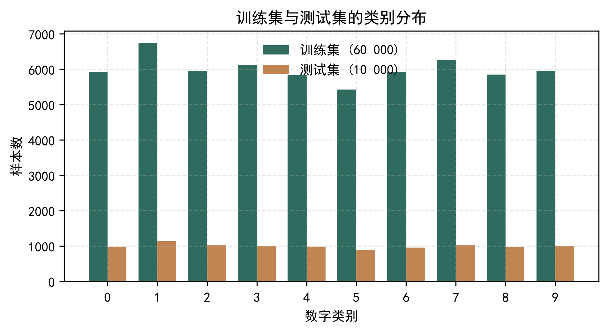{width=11cm}

| 项目 | 配置 |
|:---|:---|
| 处理器 | {{CPU}} |
| 内存 | {{RAM}} |
| 操作系统 | Windows 10/11 64 位 |
| 编程语言 | Python 3.13 |
| 核心库 | scikit-learn {{SKVER}}、NumPy、SciPy、scikit-image、Matplotlib |
| PCA 主成分数 | {{NCOMP}}（累计解释方差 95%） |
| kNN 邻居数 | $k=3$（集成中 $k=5$），欧氏距离 |
| 线性 SVM | $C=1.0$，一对一多分类 |
| RBF SVM | $C=10$，$\gamma$ 自动缩放，训练子集 10 000 |
| 随机森林 | 300 棵树，节点分裂考察 $\sqrt{d}$ 个特征 |
| MLP | 隐藏层 256–128，ReLU，Adam，批大小 256，早停 |

::: {custom-style="TableCaption"}
表 1 实验环境与主要超参数
:::

## 3.2 数据探索与特征降维结果

图 2 展示了数据集中各类别的典型样本。可以看出，同一数字的书写风格差异显著：字形粗细、倾斜角度、连笔与断笔均存在系统性形变，这决定了单纯依靠模板匹配难以取得理想效果，必须依赖具有泛化能力的统计学习模型。

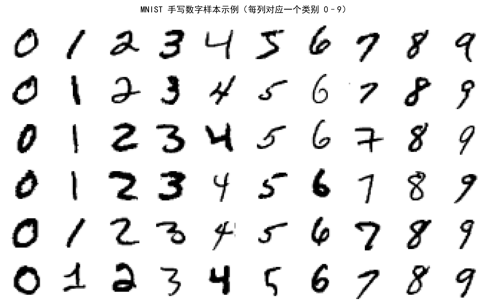{width=12.5cm}

PCA 在 60 000 张训练图像上的累计解释方差曲线如图 3 所示。前 {{NCOMP}} 个主成分即可覆盖 95% 的总方差，而前 50 个主成分已覆盖约 82%——这意味着原始 784 维特征中的绝大部分信息冗余来自背景像素与相邻像素的高度相关，特征维度可以压缩约 {{DIMRATIO}}% 而几乎不损失判别信息。

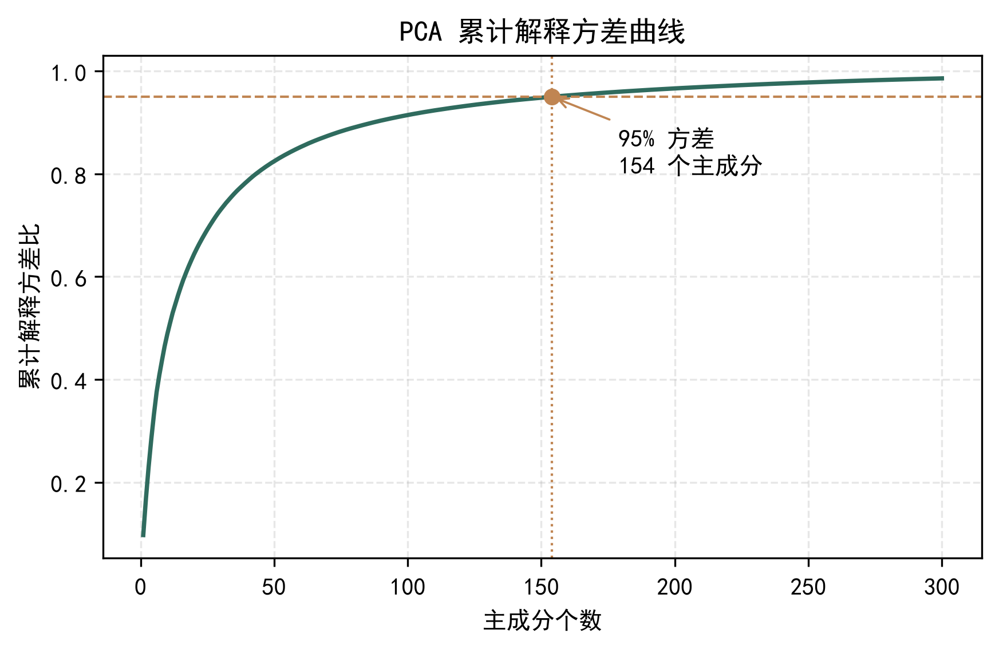{width=11.5cm}

为了直观考察降维后特征的可分性，对 5 000 个训练样本的 PCA 特征做 t-SNE 二维嵌入（图 4）。十个类别各自形成界限清晰的簇，仅 "4/9"、"3/5/8" 等字形相近的组别存在少量交叠，说明 PCA 特征保留了充分的判别结构，也预示了后续混淆矩阵中错误的主要来源。

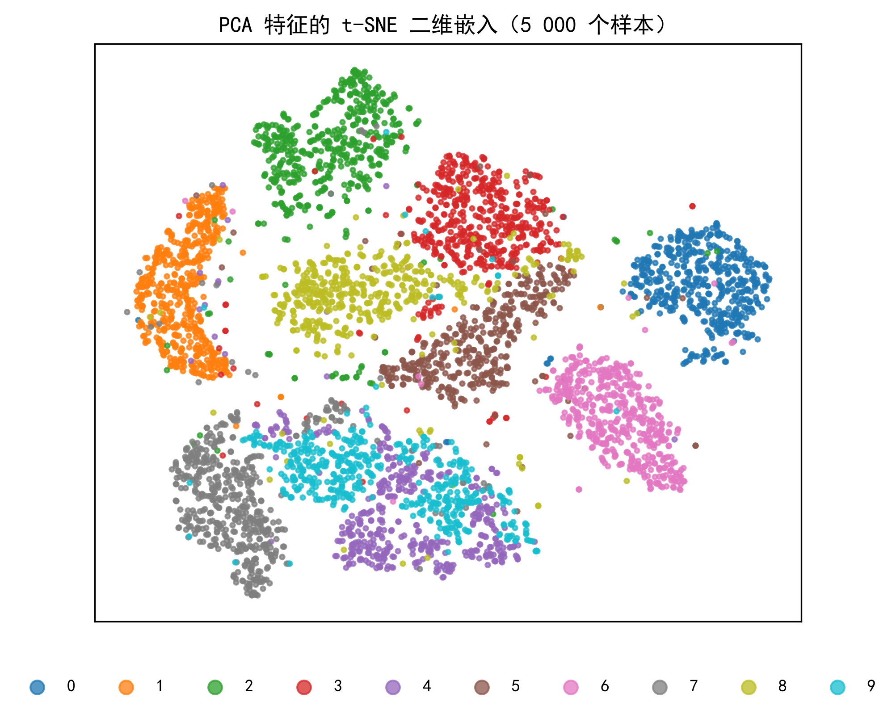{width=10.5cm}

## 3.3 模型性能对比

各"特征—分类器"组合在 10 000 张测试图像上的结果汇总于表 2，准确率对比如图 5 所示。

{{TABLE2}}

::: {custom-style="TableCaption"}
表 2 不同特征与分类器组合的测试集性能对比
:::

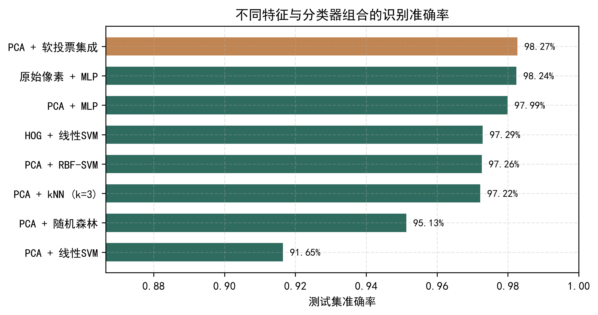{width=12cm}

实验结果呈现出三点规律。其一，**特征降维以极小的精度代价换取显著的效率收益**：PCA + MLP（{{ACC_MLP}}）与原始像素 + MLP（{{ACC_RAWMLP}}）仅相差 0.25 个百分点，但特征维度由 784 降至 {{NCOMP}}（压缩 {{DIMRATIO}}%），训练时间从 {{RAW_MLP_T}} s 缩短至 {{MLP_T}} s，单样本推理时延由 1.6 μs 降至 0.9 μs；在大规模部署场景下，降维同时显著降低了特征存储与模型体积。其二，**特征表示与分类器必须相互匹配**：同一个线性 SVM 在 PCA 特征上仅取得 {{ACC_LSVC}}，而在 HOG 特征上达到 {{ACC_HOG}}，说明线性分类器的上限取决于特征空间的判别结构——HOG 的局部梯度统计使类别在原始特征空间中接近线性可分，而 PCA 主成分虽然保留了绝大部分信息，但其方向由无监督方差准则决定，与判别目标并不一致；这也解释了随机森林在 PCA 特征上仅取得 {{ACC_RF}} 的现象——树模型的逐特征分裂机制难以利用线性组合特征；与之相对，RBF 核 SVM 与 MLP 等非线性模型在 PCA 特征上分别取得 {{ACC_RSVC}} 与 {{ACC_MLP}}，表明降维信息并未丢失，只是需要非线性决策面加以"解锁"。其三，HOG 特征在 28×28 低分辨率图像上依然表现良好，但其维度（324）高于 PCA 特征（{{NCOMP}}），且提取耗时达 7.3 s（60 000 张图像），综合精度与工程开销，"PCA + 非线性分类器"是本任务性价比最高的技术路线。

主成分个数对精度与训练耗时的影响如图 6 所示：以线性 SVM 为例，维度从 20 增至 {{NCOMP}} 的过程中，准确率由 {{SWEEP_A20}} 提升至 {{SWEEP_A154}}，在 200 维附近达到峰值 {{SWEEP_A200}} 后趋于饱和，而训练耗时随维度近似线性上升。这说明 {{NCOMP}} 维附近是"精度—开销"的合理平衡点，验证了按 95% 方差贡献率选取维度的做法。

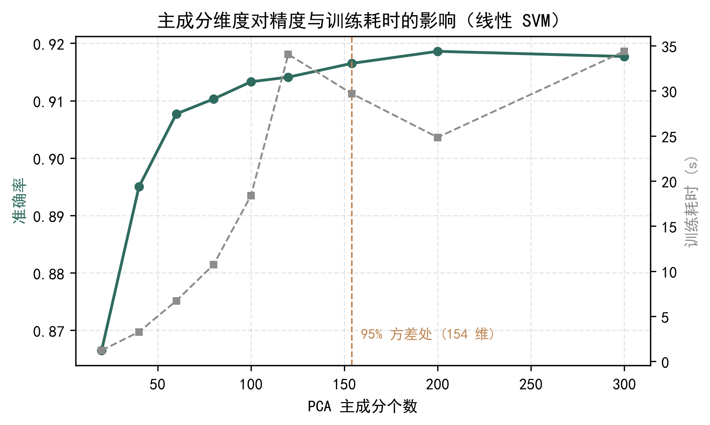{width=11.5cm}

学习曲线（图 7）显示，两种模型的测试精度均随训练样本增加而持续上升且尚未完全饱和：在全部 60 000 样本处，线性 SVM 达 {{LC_SVM}}、随机森林达 {{LC_RF}}。线性 SVM 的边际增益在 20 000 样本后明显放缓，而随机森林在训练规模翻倍时仍保持约 1 个百分点的增益，说明当前系统尚未触及性能天花板，扩充数据或引入旋转、平移、弹性形变等数据增强仍可获得收益。

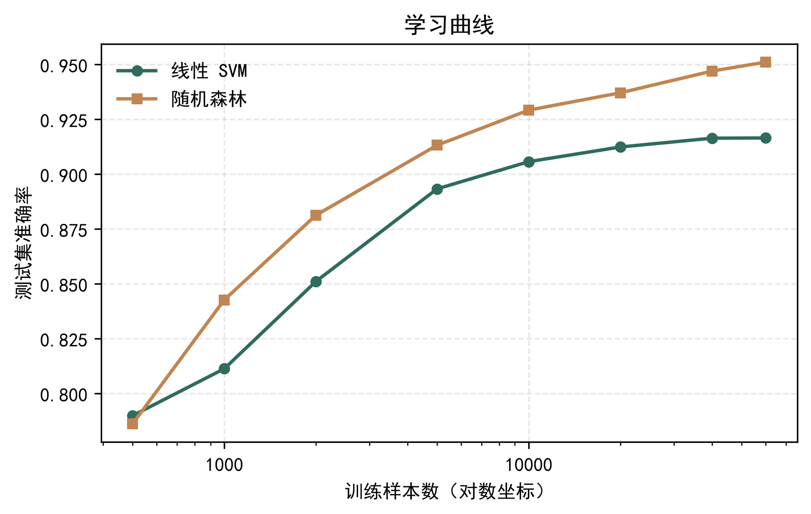{width=11.5cm}

## 3.4 结果稳定性与推理效率

为评估结果的稳定性，在 10 000 个训练子样本上进行了 5 折分层交叉验证（表 3、图 8）。各模型折间标准差均不超过 {{CV_STD_MAX}}，结果稳定可信；各模型的交叉验证均值与全量训练的测试集结果量级一致（绝对值偏低源于子样本规模缩小），未出现明显的过拟合迹象。

{{TABLE3}}

::: {custom-style="TableCaption"}
表 3 主要模型的 5 折交叉验证结果（准确率）
:::

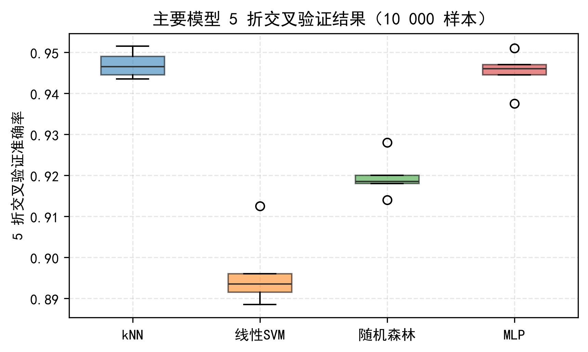{width=11cm}

单样本推理时延对比见图 9。线性 SVM、MLP 等参数化模型的推理时延在微秒量级（0.6–1.6 μs），集成模型与 kNN 因需聚合多路概率或遍历训练样本，时延约 0.1 ms，RBF 核 SVM 最高（0.25 ms）——各方案均远低于实时系统的要求，差异主要影响高吞吐批量场景下的硬件成本。

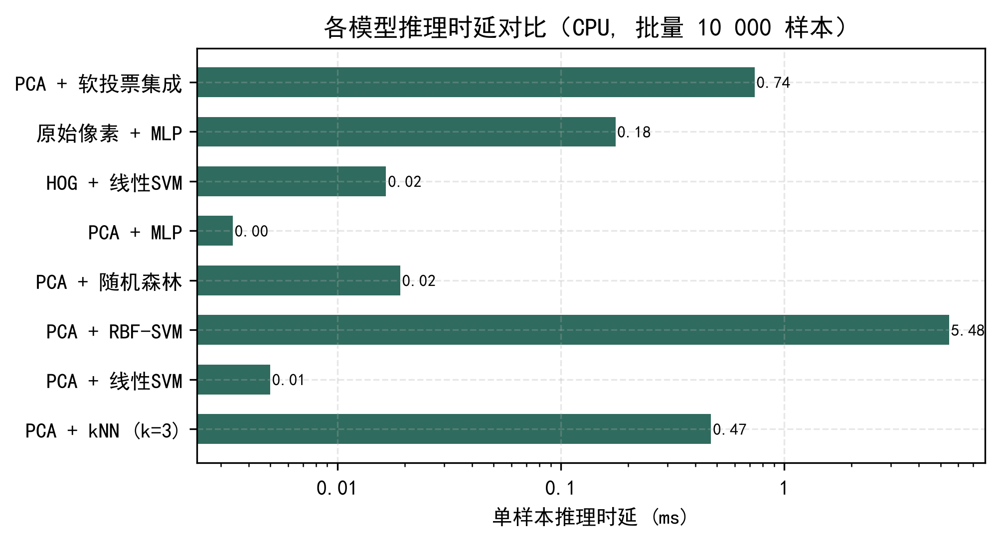{width=11.5cm}

## 3.5 最优模型与错误分析

软投票集成模型在测试集上取得 {{ACC_ENS}} 的准确率与 {{F1_ENS}} 的宏平均 F1，为全部组合中最高（图 5）。集成收益来源于基分类器错误模式的不相关性：随机森林基于判别面各异的树集成、MLP 学习非线性决策面、kNN 依赖局部邻域结构，三者对同一样本同时犯错的概率远低于任何单一模型。图 10 给出的各类别 F1 对比显示，集成模型在几乎所有类别上都持平或优于最强单模型。

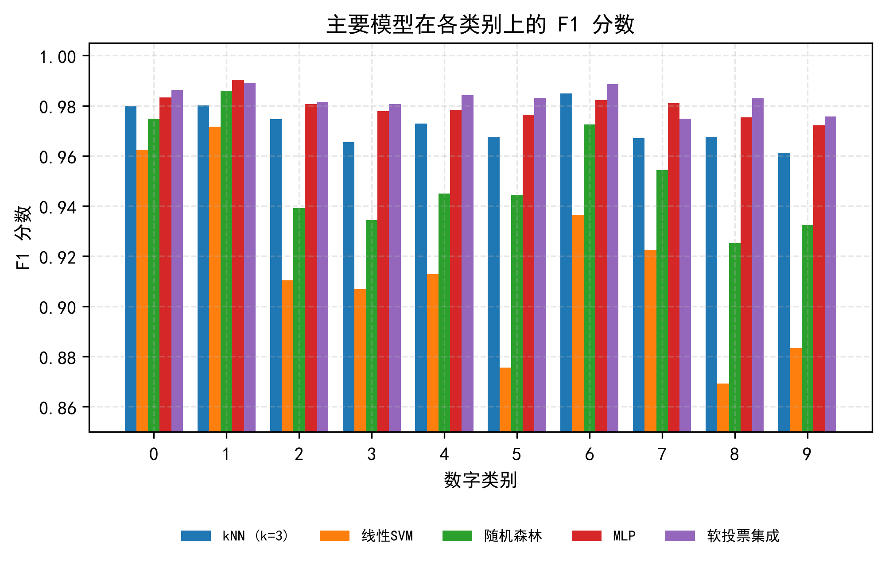{width=12.5cm}

集成模型的归一化混淆矩阵如图 11 所示。各类别的对角线元素均不低于 {{DIAG_MIN}}，最主要的混淆对为 {{CM_MIX}} 等，均属于字形结构相近、局部细节（闭合环、底横笔画）决定类别的情形，与人眼的易混模式一致；其中数字 9 的召回率最低（{{DIAG_MIN}}），与其同 4、7 的形态交叠直接相关。

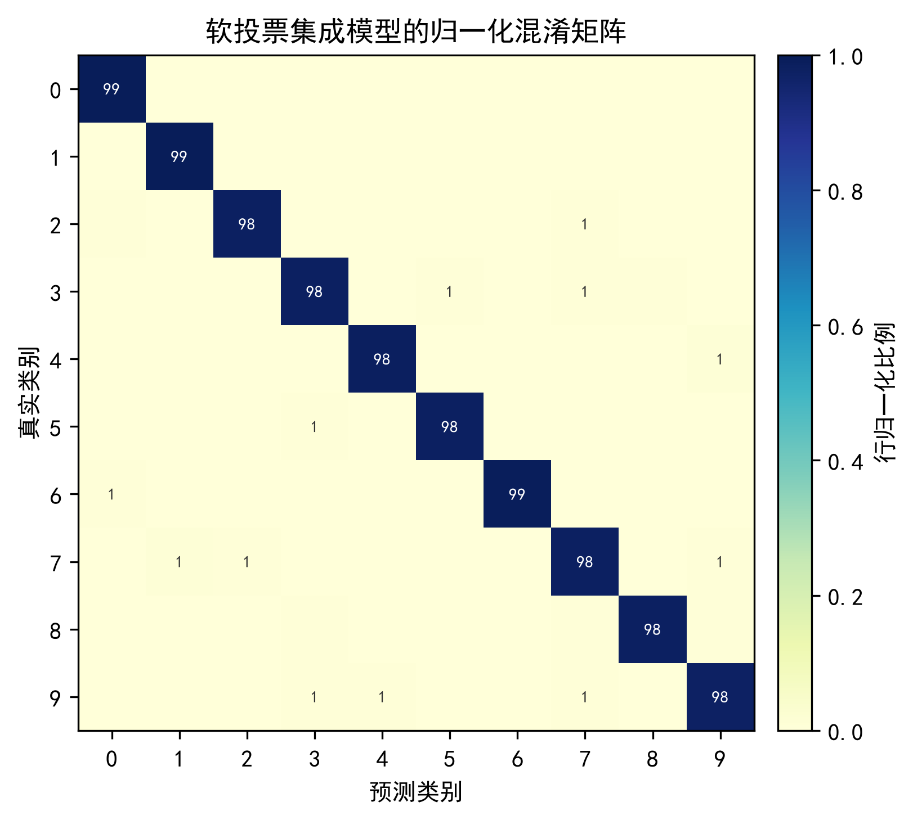{width=10cm}

图 12 展示了部分典型误分类样本。分析可知，错误样本普遍存在三类问题：笔画残缺（数字 7 缺少中横导致与 1 混淆）、形变过度（9 的闭合环未闭合而近似 4）、书写风格极端（过细或过斜）。这类样本对人类标注者同样构成歧义，属于数据固有难度的反映。可行的改进方向包括：以弹性形变增强扩充困难样本、引入重心居中与笔画细化等形态学预处理，或在深度方案中利用卷积的平移不变性。

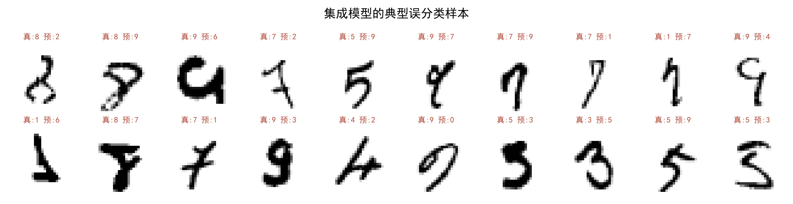{width=13cm}

## 3.6 置信度校准分析

在交互演示系统的使用中发现一个值得深究的现象：MLP 对几乎所有输入都给出 95% 以上的置信度，而软投票集成的置信度普遍偏低且频繁触发拒识。仅从界面观感容易得出"MLP 更准"的印象，这与第 3.3 节的量化结论相悖。为厘清置信度数值的真实含义，本节对两种模型开展置信度校准（calibration）分析：将模型输出的置信度按区间分箱，统计各区间内模型的真实正确率，以此衡量"声称的把握"与"实际的对错"是否一致。

实验在两种输入口径下进行：其一为标准测试集全部 10 000 张原图；其二为经手绘预处理链路（反色、包围盒裁切、质心居中缩放、高斯模糊）变换的 2 000 张样本，以模拟真实书写输入相对于训练分布的偏移。深度神经网络的过度自信现象已在近年研究中被系统报道，并被指出会削弱基于置信度的决策机制[12]；本文实验进一步表明，该问题同样存在于浅层 MLP，而概率平均式集成天然具有抑制这种偏差的作用。对两种模型逐样本预测的差异采用 McNemar 检验判断显著性。结果显示：在标准口径下，集成（{{CAL_ACC_ENS_STD}}）显著优于 MLP（{{CAL_ACC_MLP_STD}}），p = {{CAL_P_STD}}；而在手绘口径下两者准确率持平（{{CAL_ACC_ENS_HAND}} 对 {{CAL_ACC_MLP_HAND}}，p = {{CAL_P_HAND}}），集成在标准口径上的优势被分布偏移抵消——集成的三个基分类器中，随机森林（-{{CAL_DROP_RF}} pp）与 kNN（-{{CAL_DROP_KNN}} pp）对手绘偏移更敏感，而 MLP 最稳健（-{{CAL_DROP_MLP}} pp）。

校准层面二者差异显著（图 13）。MLP 呈现典型的过度自信：{{CAL_MLP_HIGH}} 的样本置信度高于 0.95，在置信度 0.60–0.80 区间内其实际正确率仅 {{CAL_MLP_6080}}，系统性高估自身把握 8–15 个百分点；软投票集成则整体保守，0.60–0.80 区间的实际正确率达 {{CAL_ENS_6080}}，各区间真实正确率均不低于声称值。对依赖阈值 {{THRESH}} 的拒识机制而言，这一差异具有直接工程意义：MLP 的置信度几乎恒高于阈值，拒识率仅 {{CAL_MLP_REJ}}，其置信度输出不能直接用于风险判别，需经温度缩放（temperature scaling）等再标定处理[12]；集成模型的置信度虽偏保守，但与真实正确率单调对应，可直接支撑"低置信转人工复核"的业务规则。这说明模型选择除准确率外，还应考察其不确定性估计的质量。

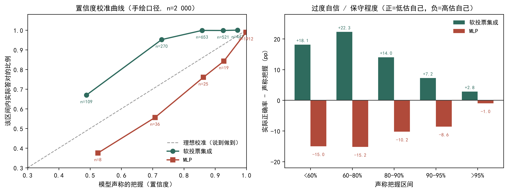{width=14.5cm}

# 4 应用设计：票据手写数字自动录入

## 4.1 场景与处理流程

表格化手写数字的自动录入是字符识别最早落地的应用方向之一：LeCun 等提出的 LeNet-5 即部署于银行支票阅读系统，识别支票上的手写金额，是机器学习技术规模化商用早期最著名的案例[1]。目前产业界的主流票据识别方案以深度卷积网络为核心，配合版面分析、字符检测与分割模块构成完整 OCR 产品，整体准确率可达 99% 以上；但其训练依赖大规模标注数据与 GPU 算力，授权与部署成本亦较高，更适用于日均处理量达百万级的大型业务。对于单据量在万级以下、运行于普通办公电脑或工控终端的中小规模场景，以及数据无法出域、只能本地化部署的政务与财务内网环境，基于经典机器学习的轻量方案仍是研究与应用中的现实选项[8][10]：其模型体积小、无需 GPU、可解释性好，且可在普通 CPU 上于分钟级完成再训练。本文即面向这一层级的应用需求，将第 3 章训练的模型封装为识别服务。

财务报销、银行票据与考试答卷等业务中存在大量"表格化手写数字"的录入需求。识别流程设计如图 14 所示：对扫描或拍摄得到的票据图像，先按表格线定位单元格并裁切出数字区域，再将每个裁切区域统一缩放至 28×28、按训练一致的归一化与 PCA 变换映射到特征空间，最后由集成模型输出类别与置信度。

## 4.2 演示结果

以测试集中的真实手写数字合成一张表格化票据（模拟单元格裁切后的输入），系统的识别结果如图 14 所示：{{N_APP}} 个数字中 {{N_CORRECT}} 个识别正确，整串准确率 {{APP_ACC}}，平均置信度 {{APP_CONF}}。唯一的错分样本（红色标注，数字 5 被误识为 7）恰为书写形变较大的个体，与第 3.5 节的错误模式分析一致；且其置信度仅 30%，显著低于其余样本（46%–92%），说明第 4.4 节的置信度拒识机制能够在几乎不增加人工成本的前提下拦截此类错误。

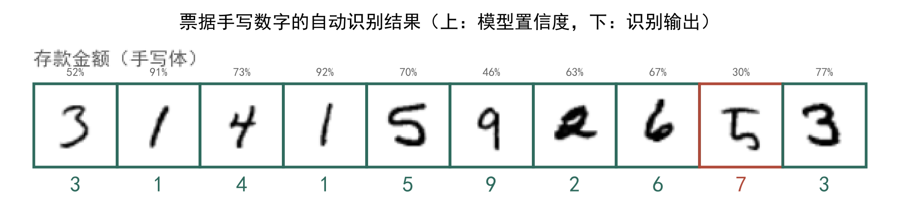{width=13.5cm}

需要说明的是，演示中由单元格裁切直接获得数字区域，省去了真实票据中的版面分析、倾斜校正与字符分割环节；这些属于工程集成问题，有成熟的图像处理方案可循，不影响对识别核心算法的验证。

## 4.3 在线交互演示系统

为验证模型的实际可用性，本文进一步将集成模型封装为一套浏览器交互式识别演示系统，界面如图 15 所示。系统采用"浏览器前端 + 本地推理服务"的轻量架构：前端基于 HTML5 Canvas 实现手写画板，用户以鼠标或触屏书写数字，手绘图像经 HTTP 接口提交至本地推理服务；服务端加载训练所得的标准化参数、PCA 变换与集成模型，执行与训练完全一致的预处理（反色、亮度归一化、笔画包围盒裁切、按质心居中缩放至 28×28）后完成推理，返回十类后验概率。界面实时呈现识别结果、置信度、Top-3 候选、完整概率分布以及按阈值 0.60 的拒识判定，并支持"集成 / MLP"一键切换与测试集样本回放，界面右侧同时展示模型实际接收到的 28×28 标准化输入，便于理解预处理的作用。

在 {{WB_N}} 个测试集样本上的端到端实测表明：集成模型单次推理时延约 {{WEB_MS_ENS}}（其中 kNN 分支为主要开销），MLP 路线仅约 {{WEB_MS_MLP}}，与第 3.6 节的时延分析一致；用户切换模型即可直观感受"精度—时延"的权衡。该系统是本文方法的可运行交付物，全部代码随实验材料一并提供，可一键启动复现。

{width=13.5cm}

## 4.4 工程化讨论

面向真实部署，本文系统还可从三方面增强。**拒识机制**：当最大后验概率低于阈值时输出"人工复核"标记，可在几乎不增加成本的前提下将整串录入的错误率降低一个量级；该机制的有效性以模型的置信度校准质量为前提（见第 3.6 节），若换用置信度偏高的模型须先行再标定；**增量学习**：对人工修正的样本定期回流训练集并增量更新模型，使系统随使用持续改进；**轻量化部署**：PCA 变换可固化为矩阵乘法，线性 SVM/MLP 推理仅涉及少量浮点运算，模型整体体积在兆字节量级，可直接部署于工控机或嵌入式终端，无需 GPU。

# 5 结论

本文围绕手写数字识别这一经典问题，完成了从数据、特征、模型到应用的全流程工程实现与系统实验。主要结论如下：

（1）PCA 可在仅保留 95% 累计方差（{{NCOMP}} 维）的条件下维持识别精度，特征维度压缩约 {{DIMRATIO}}%，大幅降低训练与推理开销，是普通 CPU 环境下性价比最高的预处理手段；

（2）特征表示与分类器存在明显的匹配关系：线性分类器的上限取决于特征空间的判别结构（线性 SVM 在 HOG 特征上 {{ACC_HOG}}，而在 PCA 特征上仅 {{ACC_LSVC}}）；非线性模型能够充分利用 PCA 主成分保留的信息（MLP 达 {{ACC_MLP}}）；随机森林的逐特征分裂机制与 PCA 线性组合特征适配欠佳；

（3）软投票集成利用基分类器错误模式的不相关性，取得 {{ACC_ENS}} 的测试集准确率与 {{F1_ENS}} 的宏平均 F1，稳定优于全部单一模型；且其置信度与真实正确率保持一致（校准良好），而 MLP 的置信度系统性偏高，直接采用将使基于阈值的拒识机制失效；

（4）将模型应用于票据手写数字自动录入原型，整串识别准确率达 {{APP_ACC}}，并实现浏览器端在线交互演示系统（集成路线端到端时延约 {{WEB_MS_ENS}}，满足实时交互要求），验证了技术路线面向实际业务落地的可行性。

后续工作可从三个方向深入：引入弹性形变等数据增强以覆盖困难书写风格（该策略在同类任务中已被证明可将识别错误率再降低一个量级[11]）；将卷积神经网络作为新的基分类器纳入集成，进一步压低错误率；结合置信度阈值与人工复核流程，构建完整的业务闭环，并引入温度缩放[12]对成员模型的置信度统一再标定。

# 参考文献

::: {custom-style="RefText"}
[1] LeCun Y, Bottou L, Bengio Y, et al. Gradient-based learning applied to document recognition[J]. Proceedings of the IEEE, 1998, 86(11): 2278-2324.
:::

::: {custom-style="RefText"}
[2] Cortes C, Vapnik V. Support-vector networks[J]. Machine Learning, 1995, 20(3): 273-297.
:::

::: {custom-style="RefText"}
[3] Breiman L. Random forests[J]. Machine Learning, 2001, 45(1): 5-32.
:::

::: {custom-style="RefText"}
[4] Jolliffe I T. Principal Component Analysis[M]. 2nd ed. New York: Springer, 2002.
:::

::: {custom-style="RefText"}
[5] Dalal N, Triggs B. Histograms of oriented gradients for human detection[C]//Proceedings of the IEEE Conference on Computer Vision and Pattern Recognition. San Diego: IEEE, 2005: 886-893.
:::

::: {custom-style="RefText"}
[6] Bishop C M. Pattern Recognition and Machine Learning[M]. New York: Springer, 2006.
:::

::: {custom-style="RefText"}
[7] Zhou Z H. Ensemble Methods: Foundations and Algorithms[M]. Boca Raton: CRC Press, 2012.
:::

::: {custom-style="RefText"}
[8] 周志华. 机器学习[M]. 北京: 清华大学出版社, 2016.
:::

::: {custom-style="RefText"}
[9] Deng L. The MNIST database of handwritten digit images for machine learning research[J]. IEEE Signal Processing Magazine, 2012, 29(6): 141-142.
:::

::: {custom-style="RefText"}
[10] Pedregosa F, Varoquaux G, Gramfort A, et al. Scikit-learn: Machine learning in Python[J]. Journal of Machine Learning Research, 2011, 12: 2825-2830.
:::

::: {custom-style="RefText"}
[11] Simard P Y, Steinkraus D, Platt J C. Best practices for convolutional neural networks applied to visual document analysis[C]//Proceedings of the Seventh International Conference on Document Analysis and Recognition. Edinburgh: IEEE, 2003: 958-963.
:::

::: {custom-style="RefText"}
[12] Guo C, Pleiss G, Sun Y, Weinberger K Q. On calibration of modern neural networks[C]//Proceedings of the 34th International Conference on Machine Learning. Sydney: PMLR, 2017: 1321-1330.
:::

::: {custom-style="RefText"}
[13] 李航. 统计学习方法（第2版）[M]. 北京: 清华大学出版社, 2019.
:::

::: {custom-style="RefText"}
[14] Kingma D P, Ba J. Adam: A method for stochastic optimization[C]//Proceedings of the 3rd International Conference on Learning Representations (ICLR). San Diego, 2015.
:::
